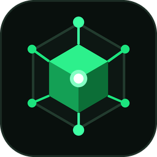
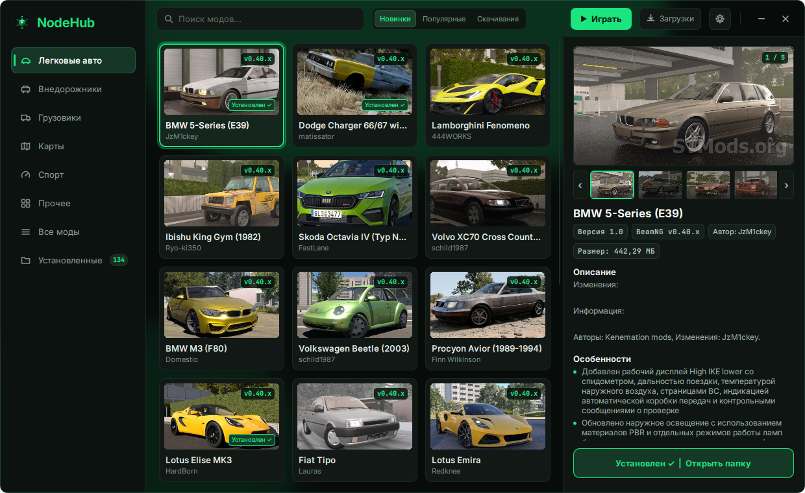

<div align="center">
  
  <h1>NodeHub</h1>
  <p>Лаунчер и менеджер модов для BeamNG.drive с каталогом STMods.</p>

  <p>
    <a href="https://github.com/lidamargin-coder/NodeHub/releases/latest/download/NodeHub_Setup_v1.0.0.exe">
      
    </a>
  </p>

  <p>
    <a href="https://lidamargin-coder.github.io/NodeHub/">
      
    </a>
    
    
  </p>
</div>

---

<div align="center">
  
</div>

## Возможности

- **Скачивание без браузера**: автоматический обход страниц загрузки и очередь до 5 файлов одновременно.
- **Автосортировка**: карты направляются в `content/levels`, техника — в `content/vehicles`.
- **Менеджер установленных модов**: мгновенное сканирование, переключение (`.zip` ↔ `.zip.disabled`) без удаления.
- **Запуск игры**: автопоиск 64-битного бинарника BeamNG.drive и запуск в один клик.

## Сборка из исходников

Требования: **Qt 6.8+ (MinGW 64-bit)**, **CMake 3.21+**, **Ninja**, **Inno Setup 6** (для установщика).

```cmd
build.bat            # Сборка NodeHub.exe в папку build/
build_dist.bat       # Автономный дистрибутив с Qt runtime в dist/NodeHub/
build_installer.bat  # Сборка Windows Setup в dist/NodeHub_Setup_v1.0.0.exe
```

## Правовой статус

NodeHub — бесплатный фанатский проект с открытым исходным кодом. Не аффилирован и не связан с BeamNG GmbH или администрацией stmods.org. Все права на модификации и товарные знаки принадлежат их законным авторам.
